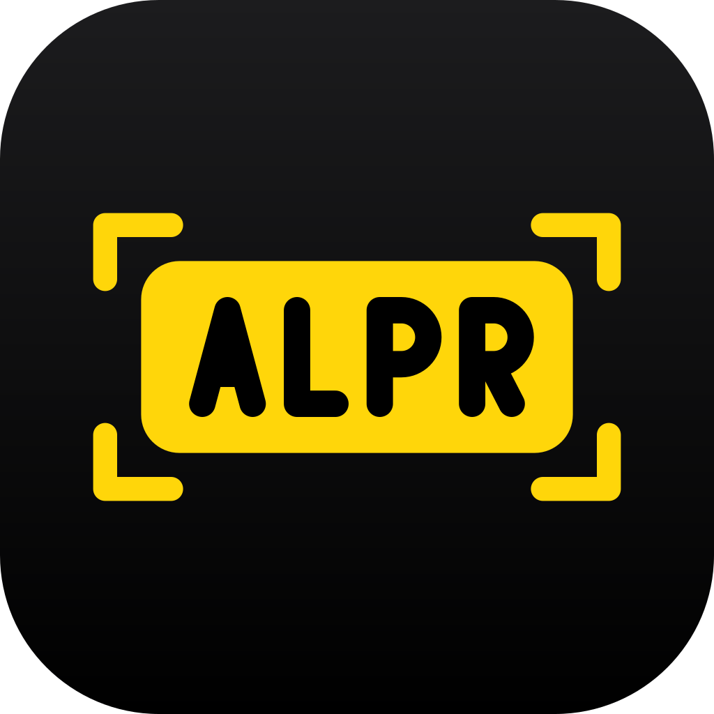

<p align="center">
  
</p>

<h1 align="center">react-native-alpr</h1>

<p align="center">On-device license plate recognition (ALPR/ANPR) for React Native and Expo.</p>

<p align="center">
  <a href="https://www.npmjs.com/package/react-native-alpr"></a>
  <a href="https://github.com/parkr-app/react-native-alpr/actions/workflows/ci.yml"></a>
  
</p>

<p align="center">
  
  
  
  
</p>
<p align="center"><sub>The <a href="example">example app</a> on iPhone and Android. Photos: Norsk Elbilforening and Mariordo, <a href="https://creativecommons.org/licenses/by/2.0/">CC BY 2.0</a>, via <a href="https://commons.wikimedia.org/wiki/Category:Electric_vehicle_license_plates_of_Norway">Wikimedia Commons</a>, cropped.</sub></p>

- Fully offline, runs on the device (Core ML on iOS, LiteRT from Google Play services on Android)
- Live camera scanning at 30 FPS with GPU or Neural Engine acceleration
- Plate text, country and bounding box, several plates per frame, [65 countries](#supported-countries)
- Stable results: reads from several frames are combined into one answer, and boxes move smoothly
- One-shot scanning that waits for a certain read instead of taking the first blurry frame
- Recognition in photos

**The basic scanner is free, also in production.** PRO features need a license key in release builds and work without one in development builds. See [Licensing](#licensing) and [alpr.parkr.app](https://alpr.parkr.app).

## Platforms

One license key covers your app on every platform.

| Platform | Package | Repository |
| --- | --- | --- |
| Expo and React Native | `react-native-alpr` on npm | [parkr-app/react-native-alpr](https://github.com/parkr-app/react-native-alpr) |
| iOS (Swift) | `AlprKit` through Swift Package Manager | [parkr-app/alpr-ios](https://github.com/parkr-app/alpr-ios) |
| Android (Kotlin) | `app.parkr:alpr` | [parkr-app/alpr-android](https://github.com/parkr-app/alpr-android) |
| Flutter | `flutter_alpr`, in development | [parkr-app/flutter_alpr](https://github.com/parkr-app/flutter_alpr) |
| Capacitor | `capacitor-alpr`, in development | [parkr-app/capacitor-alpr](https://github.com/parkr-app/capacitor-alpr) |

## Supported countries

The model reads plates from 65 countries and reports the country of each plate as `country` and its ISO code as `countryCode`:

🇦🇱 Albania (`AL`), 🇦🇩 Andorra (`AD`), 🇦🇷 Argentina (`AR`), 🇦🇲 Armenia (`AM`), 🇦🇺 Australia (`AU`), 🇦🇹 Austria (`AT`), 🇦🇿 Azerbaijan (`AZ`), 🇧🇭 Bahrain (`BH`), 🇧🇾 Belarus (`BY`), 🇧🇪 Belgium (`BE`), 🇧🇦 Bosnia and Herzegovina (`BA`), 🇧🇷 Brazil (`BR`), 🇧🇬 Bulgaria (`BG`), 🇰🇭 Cambodia (`KH`), 🇨🇦 Canada (`CA`), 🇭🇷 Croatia (`HR`), 🇨🇾 Cyprus (`CY`), 🇨🇿 Czech Republic (`CZ`), 🇩🇰 Denmark (`DK`), 🇪🇪 Estonia (`EE`), 🇫🇮 Finland (`FI`), 🇫🇷 France (`FR`), 🇬🇪 Georgia (`GE`), 🇩🇪 Germany (`DE`), 🇬🇮 Gibraltar (`GI`), 🇬🇷 Greece (`GR`), 🇬🇬 Guernsey (`GG`), 🇭🇺 Hungary (`HU`), 🇮🇸 Iceland (`IS`), 🇮🇩 Indonesia (`ID`), 🇮🇪 Ireland (`IE`), 🇮🇱 Israel (`IL`), 🇮🇹 Italy (`IT`), 🇱🇻 Latvia (`LV`), 🇱🇮 Liechtenstein (`LI`), 🇱🇹 Lithuania (`LT`), 🇱🇺 Luxembourg (`LU`), 🇲🇾 Malaysia (`MY`), 🇲🇹 Malta (`MT`), 🇲🇽 Mexico (`MX`), 🇲🇩 Moldova (`MD`), 🇲🇨 Monaco (`MC`), 🇲🇪 Montenegro (`ME`), 🇳🇱 Netherlands (`NL`), 🇳🇿 New Zealand (`NZ`), 🇲🇰 North Macedonia (`MK`), 🇳🇴 Norway (`NO`), 🇵🇱 Poland (`PL`), 🇵🇹 Portugal (`PT`), 🇶🇦 Qatar (`QA`), 🇷🇴 Romania (`RO`), 🇸🇲 San Marino (`SM`), 🇷🇸 Serbia (`RS`), 🇸🇬 Singapore (`SG`), 🇸🇰 Slovakia (`SK`), 🇸🇮 Slovenia (`SI`), 🇪🇸 Spain (`ES`), 🇸🇪 Sweden (`SE`), 🇨🇭 Switzerland (`CH`), 🇹🇭 Thailand (`TH`), 🇹🇷 Turkey (`TR`), 🇺🇦 Ukraine (`UA`), 🇬🇧 United Kingdom (`GB`), 🇺🇸 United States (`US`), 🇻🇳 Vietnam (`VN`).

## Installation

```sh
npx expo install react-native-alpr
```

This is an Expo module. It works in Expo dev clients and in bare React Native apps with [Expo modules installed](https://docs.expo.dev/bare/installing-expo-modules/) (`npx install-expo-modules`). It does not run in Expo Go.

The package includes the native SDK (a signed `AlprKit.xcframework` and the `app.parkr:alpr` AAR) with its models, so installing and building need no extra downloads or repositories.

Add the config plugin to `app.json`:

```json
{
  "expo": {
    "plugins": [
      ["react-native-alpr", { "cameraPermission": "Allow $(PRODUCT_NAME) to scan license plates." }]
    ]
  }
}
```

Then rebuild the native app:

```sh
npx expo prebuild
```

| Plugin option | Description |
| --- | --- |
| `cameraPermission` | iOS camera usage text. `false` leaves `Info.plist` untouched. |
| `licenseKey` | Your license key. One key covers your iOS bundle id and your Android application id, also when they differ. |
| `telemetry` | Initial runtime telemetry setting, see [Telemetry](#telemetry). |

Requirements: iOS 15.1+, Android 7.0+ (API 24) with Google Play services.

## Usage

### Live camera

```tsx
import { Button } from 'react-native';
import { AlprCameraView, useCameraPermissions } from 'react-native-alpr';

function Scanner() {
  const [permission, requestPermission] = useCameraPermissions();

  if (!permission?.granted) {
    return <Button title="Allow camera" onPress={requestPermission} />;
  }

  return (
    <AlprCameraView
      style={{ flex: 1 }}
      onPlate={(plate) => console.log('Read', plate.plate, plate.countryCode)}
    />
  );
}
```

Boxes and labels are drawn natively on the preview. Boxes are smoothed and stay put through a missed frame, and a label shows `…` until the plate's text is confirmed.

### Events

Pick the event that matches what your app does:

| Event | Fires | Use it for |
| --- | --- | --- |
| `onPlate(plate)` | Once per plate, about 0.1 s after it is read clearly. Not again when the same plate briefly leaves and re-enters the view. | Continuous scanning: parking gates, patrol, logging every car that passes. PRO |
| `onScan(plate)` | Once per activation, when the reads are certain: about 0.3 s of sharp, agreeing frames. Waits rather than guessing on a blurry plate. Picks the largest plate when several are in view. | Scanning one plate with the phone, where there is no second chance. PRO |
| `onPlates(plates, frame)` | Every frame (see `throttle`), with the confirmed plates currently in view: consensus text, smoothed boxes. | Showing what is in view, your own overlay. |
| `onPlatesRaw(plates, frame)` | Every frame (see `throttle`), with every plate read in that frame, unsmoothed. | Debugging, your own tracking. |

All plates have the same shape, see [Types](#types).

```tsx
import { useState } from 'react';
import { AlprCameraView, type DetectedPlate } from 'react-native-alpr';

function ScanOnce({ onDone }: { onDone: (plate: string) => void }) {
  const [scanned, setScanned] = useState<DetectedPlate | null>(null);
  return (
    <AlprCameraView
      style={{ flex: 1 }}
      isActive={!scanned}
      onScan={(plate) => {
        setScanned(plate);
        onDone(plate.plate);
      }}
    />
  );
}
```

`onScan` fires again after `isActive` goes from `false` back to `true`.

**How frames are combined.** The OCR model reads every plate character by character and gives a probability for each character in each position. The SDK averages those probabilities over the recent frames, per position. Each frame's weight depends on its weakest character, so one sharp frame outweighs many blurry ones, and older frames count less as new ones arrive. A plate is confirmed only when every character, including where the plate ends, is clear. All timings are in seconds, so results arrive equally fast at 15 and at 60 FPS.

To keep only some plates, filter in JavaScript, for example `plate.countryCode === 'NO'` or a regular expression on `plate.plate`.

### Photos (PRO)

```ts
import { scanImage } from 'react-native-alpr';

const plates = await scanImage(photoUri);
```

`scanImage` accepts `file://` and `http(s)://` URIs, plus `content://` on Android.

### Accelerator (PRO)

```tsx
<AlprCameraView accelerator="gpu" />
```

`'gpu'` (the default) uses the GPU on Android and the GPU and Neural Engine on iOS. It falls back to the CPU when the device has no usable GPU, and in release builds without a license. `'cpu'` always runs on the CPU.

### Torch, zoom and scan region (PRO)

```tsx
<AlprCameraView torch={torchOn} zoom={2} scanRegion={{ x: 0.05, y: 0.4, width: 0.9, height: 0.25 }} />
```

`scanRegion` is normalized to the view. Only that part of the frame goes to the detector. That is faster, and it helps with distant plates because the crop is scaled up to the model's input size. The area outside is dimmed; `showScanRegion={false}` (PRO) turns that off.

### Overlay style (PRO)

```tsx
<AlprCameraView overlayStyle={{ boxColor: '#22c55e', boxCornerRadius: 8, showConfidence: true }} />
```

To draw your own overlay instead, set `showOverlay={false}` (PRO) and map each `bbox` to view coordinates with `toViewRect(plate.bbox, frame, viewSize)`. `frame` is the second argument of `onPlates`.

### Simulators and emulators

Simulators have no camera. Pass `mockImage` to run the live pipeline on a still image. The overlay, tracking and events behave as with camera frames.

```tsx
<AlprCameraView mockImage={__DEV__ && isSimulator ? require('./plate.jpg') : undefined} />
```

## Licensing

| | Development builds | Release builds without a key | Release builds with a key |
| --- | --- | --- | --- |
| Live scanning, `onPlates`, `onPlatesRaw`, default overlay | ✓ | ✓ | ✓ |
| PRO features | ✓ | Off | ✓ |

Development builds are debug builds, simulators and emulators, TestFlight and ad-hoc builds. When a development build uses PRO features without a valid key, the camera view shows a small badge listing what will be off in release.

Without a key, release builds fall back quietly and never crash:

- the scanner runs on the CPU with default thresholds, throttle, styling and full frame
- the overlay and scan region dimming are always shown
- `onPlate` and `onScan` don't fire, and torch and zoom stay off
- `scanImage` rejects with `ERR_LICENSE_REQUIRED`
- each disabled feature is logged once

Get a key at [alpr.parkr.app](https://alpr.parkr.app): PRO is $1,499 one-time for one app on every platform. There is no trial; development builds unlock every PRO feature, so you can build and test with them before you buy. A key is bound to your app ids and works on every platform and framework.

- **Perpetual:** a key works forever with every SDK version released during its updates period (one year, renewable).
- **Dev and staging ids:** variants such as `.dev` and `.staging` can be added at no cost.

Add the key with the config plugin:

```json
["react-native-alpr", { "licenseKey": "eyJ2Ijox..." }]
```

Without Expo prebuild, add `AlprLicenseKey` (String) to `Info.plist`, and to `AndroidManifest.xml`:

```xml
<meta-data android:name="app.parkr.alpr.LICENSE_KEY" android:value="eyJ2Ijox..." />
```

Release builds print a warning at build time when the key is missing or doesn't match the app id.

The JavaScript and bridge code in this repository is MIT licensed. The bundled AlprKit native SDK is licensed under the [Parkr ALPR SDK License Agreement](SDK-LICENSE.md). Bundled models: see [THIRD_PARTY_NOTICES.md](THIRD_PARTY_NOTICES.md).

## Telemetry

The SDK sends small anonymous reports to `alpr.parkr.app`. They never contain device or user identifiers, images or plate data.

- **Build time:** when the app is built (Expo prebuild, Gradle, CocoaPods), it sends the app id, platform, build type, versions and license state. Set `DO_NOT_TRACK=1` or `ALPR_TELEMETRY=0` in the build environment to turn it off.
- **Runtime:** at most once a day per device, the app sends its app id and version, platform, OS and SDK versions, build type, license state and the names of disabled PRO features.
  - It is on by default without a license and off by default with one.
  - Change it with `setTelemetryEnabled(false)` at any time, or the plugin's `telemetry` option.
  - Declare it in App Store privacy details as diagnostic data not linked to the user. The iOS SDK ships a privacy manifest.

## API

### `<AlprCameraView />`

| Prop | Type | Default | |
| --- | --- | --- | --- |
| `isActive` | `boolean` | `true` | Set to `false` to stop the camera. |
| `onPlate` | `(plate: DetectedPlate) => void` | | Each plate once. For continuous scanning. See [Events](#events). PRO |
| `onScan` | `(plate: DetectedPlate) => void` | | One certain plate per activation. PRO |
| `onPlates` | `(plates: DetectedPlate[], frame: FrameInfo) => void` | | Confirmed plates in view, smoothed. |
| `onPlatesRaw` | `(plates: DetectedPlate[], frame: FrameInfo) => void` | | Every read in the current frame, unsmoothed. |
| `onError` | `(error: { code, message }) => void` | | Camera or model errors. |
| `throttle` | `number` | `200` | Minimum time between `onPlates` and `onPlatesRaw` calls, in milliseconds. PRO |
| `accelerator` | `'gpu' \| 'cpu'` | `'gpu'` | CPU when no GPU is available. PRO for GPU |
| `detectionThreshold` | `number` | `0.4` | Minimum detection confidence. PRO |
| `ocrThreshold` | `number` | `0.3` | Minimum OCR confidence. PRO |
| `torch` | `boolean` | `false` | PRO |
| `zoom` | `number` | `1` | Clamped to what the device supports. PRO |
| `scanRegion` | `BoundingBox` | | Normalized `0..1`. PRO |
| `showScanRegion` | `boolean` | `true` | Dims the area outside `scanRegion`. PRO to turn off |
| `showOverlay` | `boolean` | `true` | Draws boxes and labels. PRO to turn off |
| `overlayStyle` | `PlateOverlayStyle` | | PRO |
| `mockImage` | `string \| number` | | A still image instead of the camera. |
| `showFps` | `boolean` | `false` | FPS counter on the preview. |

`PlateOverlayStyle`:

| Field | Default |
| --- | --- |
| `boxColor` | `#FFD60A` |
| `boxBorderWidth` | `3` |
| `boxCornerRadius` | `6` |
| `labelBackgroundColor` | `boxColor` |
| `labelTextColor` | `#1C1C1E` |
| `labelFontSize` | `13` |
| `showLabel`, `showPlate`, `showCountry` | `true` |
| `showConfidence` | `false` |

### Functions

| Function | |
| --- | --- |
| `scanImage(uri, config?)` | `Promise<DetectedPlate[]>`. PRO. `config` takes `region`, `detectionThreshold`, `ocrThreshold` and `accelerator`. |
| `loadModels(config?)` | Preloads the models, to avoid a delay on the first scan. |
| `setTelemetryEnabled(enabled)` | Turns runtime telemetry on or off. Persisted on the device. |
| `useCameraPermissions()`, `getCameraPermissionsAsync()`, `requestCameraPermissionsAsync()` | Expo's standard permission response. |
| `toViewRect(bbox, frame, viewSize)` | Converts a normalized `bbox` to view coordinates, matching the aspect-fill preview. |

### Types

```ts
type DetectedPlate = {
  plate: string;
  ocrConfidence: number;
  detectionConfidence: number;
  bbox: { x: number; y: number; width: number; height: number };
  country: string;
  countryCode: string | null;
  countryConfidence: number;
};
```

- `bbox` is normalized to `0..1`, relative to the upright frame or image.
- `country` is the region predicted by the OCR model, e.g. `"Norway"`. `countryCode` is its ISO code, e.g. `"NO"`, or `null`.
- All confidences are in `0..1`. `ocrConfidence` is the confidence of the least certain character, so one unreadable character makes it low. In `onPlates`, `onPlate` and `onScan` it is combined over the frames.

### Errors

Errors from `scanImage` and `onError` carry a `code`:

| Code | Meaning |
| --- | --- |
| `ERR_LICENSE_REQUIRED` | A PRO feature was used in a release build without a valid key. |
| `ERR_MODEL_LOAD` | The bundled models could not be loaded. |
| `ERR_CAMERA` | No camera, or no camera permission. |
| `ERR_FILE` | The image could not be read. |

## Example app

The [`example/`](example) folder has a live scanner, a photo picker and sample images.

```sh
yarn install
yarn fetch-binaries
yarn example expo prebuild
yarn example ios
yarn example android
```

`yarn fetch-binaries` downloads AlprKit.xcframework for this version from the [alpr-ios](https://github.com/parkr-app/alpr-ios/releases) GitHub release into `ios/`. `npm pack` and `npm publish` refuse to run without it, so a published package always bundles it. Android resolves `app.parkr:alpr` from Maven Central. To try the PRO features in a release build of the example, set `ALPR_LICENSE_KEY` before `expo prebuild`. On a simulator, turn on "Use test image instead of camera" in the scanner settings, or launch with `-alprMock 1`.

## Support

Questions and bugs: [GitHub issues](https://github.com/parkr-app/react-native-alpr/issues). Licensing: [post@parkr.app](mailto:post@parkr.app).

Made by [Bileier AS](https://alpr.parkr.app). Models from [fast-plate-ocr](https://github.com/ankandrew/fast-plate-ocr) and [open-image-models](https://github.com/ankandrew/open-image-models) by ankandrew.
