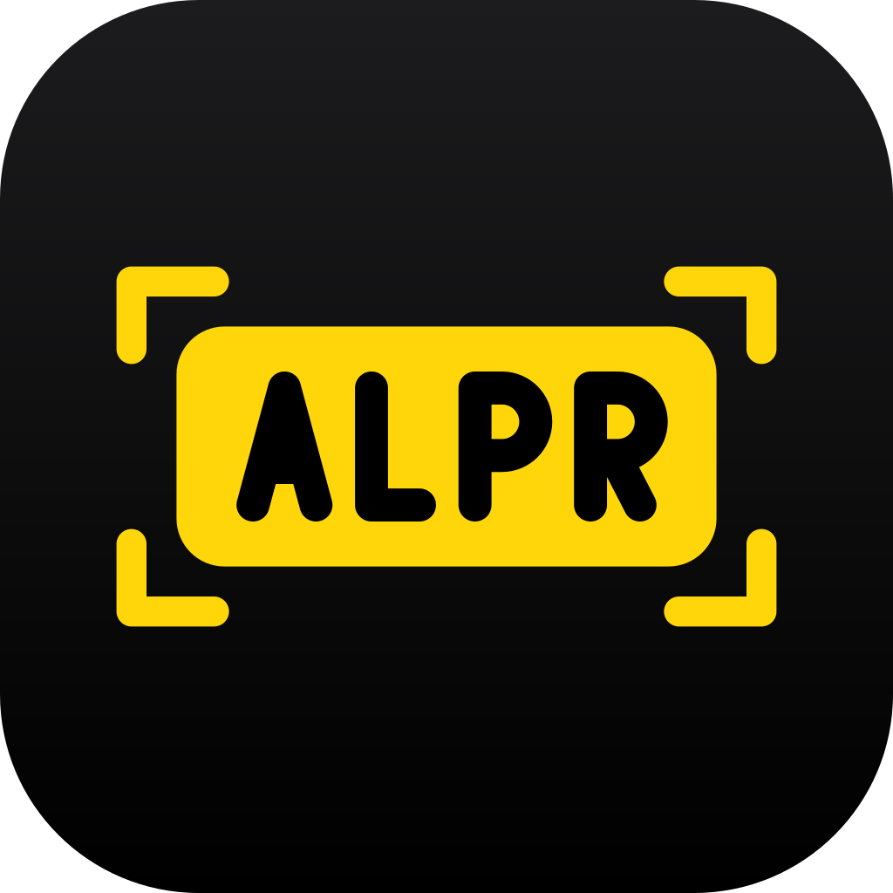

<p align="center">
  
</p>

<h1 align="center">react-native-alpr</h1>

<p align="center">On-device license plate recognition (ALPR/ANPR) for React Native and Expo.</p>

<p align="center">
  <a href="https://www.npmjs.com/package/react-native-alpr"></a>
  <a href="https://github.com/parkr-app/react-native-alpr/actions/workflows/ci.yml"></a>
  
</p>

<p align="center">
  
  
  
  
</p>
<p align="center"><sub>The <a href="example">example app</a> on iPhone and Android. Photos: Norsk Elbilforening and Mariordo, <a href="https://creativecommons.org/licenses/by/2.0/">CC BY 2.0</a>, via <a href="https://commons.wikimedia.org/wiki/Category:Electric_vehicle_license_plates_of_Norway">Wikimedia Commons</a>, cropped.</sub></p>

- Fully offline, runs on the device (Core ML on iOS, LiteRT from Google Play services on Android)
- Live camera scanning at 30 FPS with GPU or Neural Engine acceleration
- Plate text, country and bounding box, several plates per frame, [65 countries](#supported-countries)
- Stable results: reads from several frames are combined into one answer, and boxes move smoothly
- One-shot scanning that waits for a certain read instead of taking the first blurry frame
- Recognition in photos

**The basic scanner is free, also in production.** PRO features need a license key in release builds and work without one in development builds. See [Licensing](#licensing) and [alpr.parkr.app](https://alpr.parkr.app/?utm_source=readme-react-native).

## Platforms

One license key covers your app on every platform.

| Platform | Package | Repository |
| --- | --- | --- |
| Expo and React Native | `react-native-alpr` on npm | [parkr-app/react-native-alpr](https://github.com/parkr-app/react-native-alpr) |
| iOS (Swift) | `AlprKit` through Swift Package Manager | [parkr-app/alpr-ios](https://github.com/parkr-app/alpr-ios) |
| Android (Kotlin) | `app.parkr:alpr` | [parkr-app/alpr-android](https://github.com/parkr-app/alpr-android) |
| Flutter | `flutter_alpr`, in development | [parkr-app/flutter_alpr](https://github.com/parkr-app/flutter_alpr) |
| Capacitor | `capacitor-alpr`, in development | [parkr-app/capacitor-alpr](https://github.com/parkr-app/capacitor-alpr) |

## Supported countries

The model reads plates from 65 countries and reports the country of each plate as `country` and its ISO code as `countryCode`:

| Country | Code | Country | Code | Country | Code |
|---|---|---|---|---|---|
| 🇦🇱 Albania | `AL` | 🇬🇪 Georgia | `GE` | 🇳🇿 New Zealand | `NZ` |
| 🇦🇩 Andorra | `AD` | 🇩🇪 Germany | `DE` | 🇲🇰 North Macedonia | `MK` |
| 🇦🇷 Argentina | `AR` | 🇬🇮 Gibraltar | `GI` | 🇳🇴 Norway | `NO` |
| 🇦🇲 Armenia | `AM` | 🇬🇷 Greece | `GR` | 🇵🇱 Poland | `PL` |
| 🇦🇺 Australia | `AU` | 🇬🇬 Guernsey | `GG` | 🇵🇹 Portugal | `PT` |
| 🇦🇹 Austria | `AT` | 🇭🇺 Hungary | `HU` | 🇶🇦 Qatar | `QA` |
| 🇦🇿 Azerbaijan | `AZ` | 🇮🇸 Iceland | `IS` | 🇷🇴 Romania | `RO` |
| 🇧🇭 Bahrain | `BH` | 🇮🇩 Indonesia | `ID` | 🇸🇲 San Marino | `SM` |
| 🇧🇾 Belarus | `BY` | 🇮🇪 Ireland | `IE` | 🇷🇸 Serbia | `RS` |
| 🇧🇪 Belgium | `BE` | 🇮🇱 Israel | `IL` | 🇸🇬 Singapore | `SG` |
| 🇧🇦 Bosnia and Herzegovina | `BA` | 🇮🇹 Italy | `IT` | 🇸🇰 Slovakia | `SK` |
| 🇧🇷 Brazil | `BR` | 🇱🇻 Latvia | `LV` | 🇸🇮 Slovenia | `SI` |
| 🇧🇬 Bulgaria | `BG` | 🇱🇮 Liechtenstein | `LI` | 🇪🇸 Spain | `ES` |
| 🇰🇭 Cambodia | `KH` | 🇱🇹 Lithuania | `LT` | 🇸🇪 Sweden | `SE` |
| 🇨🇦 Canada | `CA` | 🇱🇺 Luxembourg | `LU` | 🇨🇭 Switzerland | `CH` |
| 🇭🇷 Croatia | `HR` | 🇲🇾 Malaysia | `MY` | 🇹🇭 Thailand | `TH` |
| 🇨🇾 Cyprus | `CY` | 🇲🇹 Malta | `MT` | 🇹🇷 Turkey | `TR` |
| 🇨🇿 Czech Republic | `CZ` | 🇲🇽 Mexico | `MX` | 🇺🇦 Ukraine | `UA` |
| 🇩🇰 Denmark | `DK` | 🇲🇩 Moldova | `MD` | 🇬🇧 United Kingdom | `GB` |
| 🇪🇪 Estonia | `EE` | 🇲🇨 Monaco | `MC` | 🇺🇸 United States | `US` |
| 🇫🇮 Finland | `FI` | 🇲🇪 Montenegro | `ME` | 🇻🇳 Vietnam | `VN` |
| 🇫🇷 France | `FR` | 🇳🇱 Netherlands | `NL` |  |  |

## Installation

```sh
npx expo install react-native-alpr
```

It works in Expo and React Native. It does not run in Expo Go.

Add the config plugin to `app.json`:

```json
{
  "expo": {
    "plugins": [
      ["react-native-alpr", { "cameraPermission": "Allow $(PRODUCT_NAME) to scan license plates." }]
    ]
  }
}
```

Then rebuild the native app:

```sh
npx expo prebuild
```

| Plugin option | Description |
| --- | --- |
| `cameraPermission` | iOS camera usage text. `false` leaves `Info.plist` untouched. |
| `licenseKey` | Your license key. One key covers your iOS bundle id and your Android application id, also when they differ. |
| `telemetry` | Initial runtime telemetry setting, see [Telemetry](#telemetry). |

Requirements: iOS 15.1+, Android 7.0+ (API 24) with Google Play services.

## Usage

### Live camera

```tsx
import { Button } from 'react-native';
import { AlprCameraView, useCameraPermissions } from 'react-native-alpr';

function Scanner() {
  const [permission, requestPermission] = useCameraPermissions();

  if (!permission?.granted) {
    return <Button title="Allow camera" onPress={requestPermission} />;
  }

  return (
    <AlprCameraView
      style={{ flex: 1 }}
      onPlate={(plate) => console.log('Read', plate.plate, plate.countryCode)}
    />
  );
}
```

### Events

| Event | Fires | |
| --- | --- | --- |
| `onPlate(plate)` | Once per plate. For continuous scanning. | PRO |
| `onScan(plate)` | Once, when a plate is read with certainty. For scanning one plate. Fires again after `isActive` turns back on. | PRO |
| `onPlates(plates, frame)` | Every frame, with the plates in view. For your own UI. | |

```tsx
function ScanOnce({ onDone }: { onDone: (plate: string) => void }) {
  const [done, setDone] = useState(false);
  return (
    <AlprCameraView
      style={{ flex: 1 }}
      isActive={!done}
      onScan={(plate) => {
        setDone(true);
        onDone(plate.plate);
      }}
    />
  );
}
```

To keep only some plates, filter in JavaScript, for example on `plate.countryCode`.

### Photos (PRO)

```ts
import { scanImage } from 'react-native-alpr';

const plates = await scanImage(photoUri);
```

Accepts `file://` and `http(s)://` URIs, plus `content://` on Android.

### Camera options (PRO)

```tsx
<AlprCameraView
  torch={torchOn}
  zoom={2}
  region={{ x: 0.05, y: 0.4, width: 0.9, height: 0.25 }}
  overlayStyle={{ boxColor: '#22c55e' }}
/>
```

`region` scans only part of the view, which is faster and helps with distant plates. To draw your own overlay, set `showOverlay={false}` and convert boxes with `toViewRect(plate.bbox, frame, viewSize)`.

### Simulators and emulators

Simulators have no camera. `mockImage` scans a still image instead:

```tsx
<AlprCameraView mockImage={__DEV__ && isSimulator ? require('./plate.jpg') : undefined} />
```

## Example app

The [`example/`](example) folder has a live scanner, a photo picker and sample images.

```sh
yarn install
yarn fetch-binaries
yarn example expo prebuild
yarn example ios
yarn example android
```

To run a release build on a connected phone, which bundles the JavaScript and needs no Metro server:

```sh
yarn example ios:device
yarn example android:device
```

## Licensing

Development builds are debug builds, simulators and emulators, TestFlight and ad-hoc builds.

Without a key, release builds fall back quietly and never crash:

- the scanner runs on the CPU with default thresholds, throttle, styling and full frame
- the overlay and scan region dimming are always shown
- `onPlate` and `onScan` don't fire, and torch and zoom stay off
- `scanImage` rejects with `ERR_LICENSE_REQUIRED`
- each disabled feature is logged once

Get a key at [alpr.parkr.app](https://alpr.parkr.app/?utm_source=readme-react-native).

Add the key with the config plugin:

```json
["react-native-alpr", { "licenseKey": "eyJ2Ijox..." }]
```

Without Expo prebuild, add `AlprLicenseKey` (String) to `Info.plist`, and to `AndroidManifest.xml`:

```xml
<meta-data android:name="app.parkr.alpr.LICENSE_KEY" android:value="eyJ2Ijox..." />
```

The JavaScript and bridge code in this repository is MIT licensed. The bundled AlprKit native SDK is licensed under the [Parkr ALPR SDK License Agreement](SDK-LICENSE.md). Bundled models: see [THIRD_PARTY_NOTICES.md](THIRD_PARTY_NOTICES.md).

## Telemetry

The SDK sends small anonymous reports to `alpr.parkr.app`. They never contain device or user identifiers, images or plate data.

- **Build time:** when the app is built (Expo prebuild, Gradle, CocoaPods), it sends the app id, platform, build type, versions and license state. Set `DO_NOT_TRACK=1` or `ALPR_TELEMETRY=0` in the build environment to turn it off.
- **Runtime:** at most once a day per device, the app sends its app id and version, platform, OS and SDK versions, build type, license state and the names of disabled PRO features. Change it with `setTelemetryEnabled(false)` or the plugin's `telemetry` option.

## API

### `<AlprCameraView />`

| Prop | Type | Default | |
| --- | --- | --- | --- |
| `isActive` | `boolean` | `true` | `false` stops the camera. |
| `onPlate`, `onScan`, `onPlates` | | | See [Events](#events). |
| `onError` | `(error: { code, message }) => void` | | |
| `throttle` | `number` | `200` | Milliseconds between `onPlates` calls. PRO |
| `accelerator` | `'gpu' \| 'cpu'` | `'gpu'` | GPU or Neural Engine, CPU as fallback. PRO |
| `detectionThreshold` | `number` | `0.4` | PRO |
| `ocrThreshold` | `number` | `0.3` | PRO |
| `torch` | `boolean` | `false` | PRO |
| `zoom` | `number` | `1` | PRO |
| `region` | `BoundingBox` | full view | Normalized `0..1`. PRO |
| `showRegion` | `boolean` | `true` | Dims outside `region`. PRO to turn off |
| `showOverlay` | `boolean` | `true` | PRO to turn off |
| `overlayStyle` | `PlateOverlayStyle` | | PRO |
| `mockImage` | `string \| number` | | Still image instead of the camera. |
| `showFps` | `boolean` | `false` | |

`PlateOverlayStyle`:

| Field | Default |
| --- | --- |
| `boxColor` | `#FFD60A` |
| `boxBorderWidth` | `3` |
| `boxCornerRadius` | `6` |
| `labelBackgroundColor` | `boxColor` |
| `labelTextColor` | `#1C1C1E` |
| `labelFontSize` | `13` |
| `showLabel`, `showPlate`, `showCountry` | `true` |
| `showConfidence` | `false` |

### Functions

| Function | |
| --- | --- |
| `scanImage(uri, config?)` | `Promise<DetectedPlate[]>`. `config` takes `region`, `detectionThreshold`, `ocrThreshold` and `accelerator`. PRO |
| `loadModels({ accelerator }?)` | Preloads the models to avoid a delay on the first scan. |
| `setTelemetryEnabled(enabled)` | Turns runtime telemetry on or off. Persisted on the device. |
| `useCameraPermissions()`, `getCameraPermissionsAsync()`, `requestCameraPermissionsAsync()` | Expo's standard permission response. |
| `toViewRect(bbox, frame, viewSize)` | Converts a `bbox` to view coordinates. |

### Types

```ts
type DetectedPlate = {
  plate: string;
  ocrConfidence: number;
  detectionConfidence: number;
  bbox: { x: number; y: number; width: number; height: number };
  country: string;
  countryCode: string | null;
  countryConfidence: number;
};
```

`bbox` and all confidences are in `0..1`. `countryCode` is an ISO code such as `"NO"`, or `null`.

### Errors

Errors from `scanImage` and `onError` carry a `code`:

| Code | Meaning |
| --- | --- |
| `ERR_LICENSE_REQUIRED` | PRO feature in a release build without a valid key. |
| `ERR_MODEL_LOAD` | The bundled models could not be loaded. |
| `ERR_CAMERA` | No camera, or no camera permission. |
| `ERR_FILE` | The image could not be read. |

## Support

Questions and bugs: [GitHub issues](https://github.com/parkr-app/react-native-alpr/issues). Licensing: [post@parkr.app](mailto:post@parkr.app).

Made by [Bileier AS](https://alpr.parkr.app/?utm_source=readme-react-native). Models from [fast-plate-ocr](https://github.com/ankandrew/fast-plate-ocr) and [open-image-models](https://github.com/ankandrew/open-image-models) by ankandrew.
